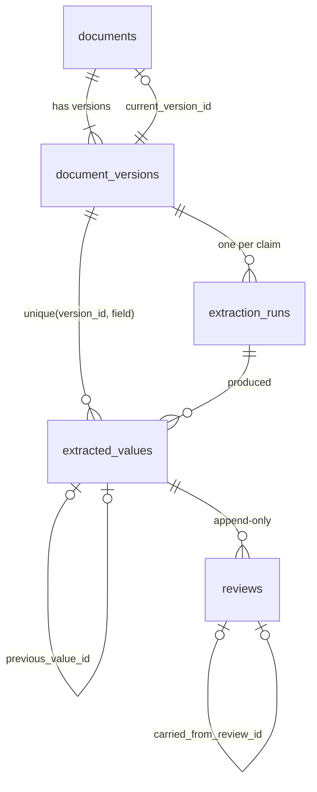

# Lomi document review

PDFs go in, an LLM extracts the fields for the document type, each value carries a verbatim quote from the
document, and a human approves or corrects every value. When a revised PDF arrives, reviews whose evidence
didn't change carry over; only what changed goes back to the reviewer.

```
upload PDF ──► API ──commit (queued)──► Postgres ◄──────────── worker ──► LLM
                │                          ▲   claim · lease · fenced commit
                └──── ring doorbell ──► Redis (BullMQ) ──► worker
web UI ──/api/*──► API (reads/writes Postgres only; never talks to the LLM)
```

## Run it

```sh
cp .env.example .env          # put your ANTHROPIC_API_KEY in it
docker compose up --build     # postgres, redis, migrate+seed, api, worker, web
```

Open **http://localhost:3000**. The seed loads version 1 of the three fixture documents as `queued`; the
worker extracts them within seconds.

**What to click first**

1. The list shows each document's status, version and review progress ("5 to review").
2. Open the invoice. Values that need you come first, each beside its verified quote; hover one and the quote
   lights up in the document text on the right. Approve a few; correct one (add a note).
3. Click **Upload new version** and pick `fixtures/documents/invoice-001.v2.pdf`. The page shows "Extracting…"
   and refreshes itself. Afterwards exactly **due date** and **total amount** are back in "Needs your review",
   each with its v1 value and v1 review beside it; the other three are under "Carried over". The version picker
   opens v1, read-only.
4. The market report has a **gap** (median household income isn't in the excerpt): it shows the reason and lets
   you confirm the gap or supply the value.

No API key, or no credit? `EXTRACTION_LLM=canned docker compose up` runs the worker with a dev-only stand-in
that answers for the four fixture PDFs (runs are logged as model `canned-dev`). Everything after the LLM call is
the real pipeline. Without a key and without that flag, the worker refuses to start and says why.

Ports: web 3000, API 3001, Postgres 25432, Redis 26379 (off-default so they don't collide with local installs;
override with `WEB_HOST_PORT`, `API_HOST_PORT`, `POSTGRES_HOST_PORT`, `REDIS_HOST_PORT`).

### Developing

```sh
corepack enable                          # or: npm i -g pnpm@12.23.0
pnpm install
docker compose up -d postgres redis      # tests use a real Postgres
pnpm turbo run build test lint typecheck # what CI runs
LIVE_LLM=1 pnpm --filter @lomi/worker exec vitest run test/live-llm.test.ts   # optional, calls the real API (a few cents)
bash scripts/chaos.sh                    # chaos pass against the Docker stack, ~8 minutes
```

## Monorepo layout

pnpm workspaces + Turborepo (`build`, `test`, `lint`, `typecheck`, `generate`; libraries build to `dist/` and
apps depend on `^build`).

| Package | What it is | May depend on |
|---|---|---|
| `apps/api` | Fastify HTTP API | db, jobs, shared, extraction (pure parts) |
| `apps/worker` | BullMQ consumer + reconciler. **The only place that calls the LLM.** | db, jobs, shared, extraction, Anthropic SDK |
| `apps/web` | Next.js (App Router) + TanStack Query review UI | shared |
| `packages/extraction` | Pure logic: PDF text, prompt + JSON schema, response parsing, evidence validation, value normalization, carry-over plan. No DB, no Redis, no SDK. | shared |
| `packages/db` | Prisma schema, migrations (with hand-written CHECKs), client, idempotent seed, test-DB helpers (`@lomi/db/testing`) | shared |
| `packages/jobs` | The queue contract: name, payload schema, `enqueueExtraction` (jobId = versionId) | — |
| `packages/shared` | Zod schemas shared by API and web: field definitions, statuses, gap reasons, the HTTP contract | — |
| `packages/config` | tsconfig + ESLint config | — |

Why these boundaries: the riskiest logic (is this quote really in the document? did this value change?) lives in
a package with no I/O, so it is tested exhaustively against the real fixture text (46 tests). The API cannot
import the LLM client, which makes "an upload never waits for the LLM" true by construction. The web bundle
only pulls in `shared`, never BullMQ or Prisma.

## Schema



- **`document_versions`** hold the PDF bytes, their sha256, the parsed text, and the extraction state machine:
  `status` (`queued | extracting | extracted | failed | superseded`), `attempt` (the fencing token, only ever
  grows), `attempts_left`, `available_at` (backoff), `lease_expires_at`, `last_error`. A document's status is its
  current version's status.
- **`extracted_values`** are immutable. Each is either an evidenced value (normalized JSON value, the exact
  quoted passage, its character offsets into *this* version's parsed text) or a **gap** (`value` NULL, a
  `gap_reason`, optional `gap_detail`). A database CHECK enforces "evidence or gap", so an unverified value cannot
  be stored even by a buggy code path. `previous_value_id` links a re-extracted value to the same field in the
  version it was compared against.
- **`reviews`** are append-only; the latest row per value is its current review. A correction is an annotation
  (`corrected_value`, `note`) beside the extracted value, which never changes: *effective value = latest
  correction ?? extracted value*. The review state is derived, never stored: no review → pending, latest review
  has `carried_from_review_id` → carried over, else approved / corrected.
- **`extraction_runs`** log every claim: prompt, raw response, model that answered, tokens, timings, outcome
  (`succeeded | failed | superseded | fenced_out | abandoned`), error.
- **Nothing is deleted** (all foreign keys are `ON DELETE RESTRICT`); every old version, value and review stays
  queryable (`GET /documents/:id/versions/:n`).

## How extraction is coordinated

**Postgres is the system of record. Redis is a doorbell.** Every state a user can see (status, attempts, errors,
leases, values, reviews, run logs) lives in Postgres. A Redis job only says "look at version X".

1. **Commit, then enqueue.** Upload writes the version (`queued`) in a transaction, then enqueues with
   `jobId = versionId`. If Redis is down the upload still returns 202 (in ~100 ms); the reconciler catches up.
2. **Atomic claim with a lease.** One conditional `UPDATE … RETURNING`: claimable if `queued`, or `extracting`
   with an expired lease, with attempts left and backoff elapsed. It increments `attempt`. Zero rows means
   someone else owns it, so the worker walks away.
3. **Heartbeat.** While the LLM call runs, the worker extends its lease every 15 s. If the extension is refused
   (superseded, or re-claimed after a stall), it aborts the LLM call.
4. **Fenced commit.** Values, carried reviews, status `extracted` and the run outcome are written in one
   transaction, only if the row still has this worker's `attempt` and status `extracting`. `unique(version_id,
   field)` makes duplicates impossible regardless.
5. **Reconciler** (worker startup + every 30 s): re-enqueues every version Postgres says is due, marks expired
   leases with no attempts left as `failed` with a readable message, and marks runs whose worker died as
   `abandoned`. That is what makes a restart, a killed container or `FLUSHALL` harmless.
6. **Failure is a state.** Transient LLM errors (429, 5xx, network) back off and retry automatically, at most 3
   attempts. Everything else (unparseable PDF, refusal, truncated or malformed response) is `failed` with the
   error shown in the UI and a **Retry** button (`POST /documents/:id/retry`, which refills the attempts).

[`docs/chaos.md`](docs/chaos.md) has the scripted proof: SIGKILL and `docker compose restart` mid-extraction,
`FLUSHALL` (in-flight and queued), concurrent double uploads, two workers, v2 during v1, Redis down, Postgres
restart: 33/33 checks, no duplicates, nothing stuck.

## The open decisions, and what I chose

Each has a short entry in [`docs/decisions.md`](docs/decisions.md) with the alternatives.

- **Correction model:** annotation beside the value, not replacement. The extracted value and its evidence stay
  as the record of what the model said; the UI shows the correction with the extracted value struck through.
- **Hallucination defense:** both sides are normalized (NFKC per character, whitespace runs collapsed), then the
  quote must be an exact, case-sensitive substring of this version's parsed text, with offsets mapped back to
  the original. Beyond the brief, the quote must also *contain the value* (numbers, amounts and dates matched
  numerically or in common written forms); otherwise the field is a `value_not_in_evidence` gap. A model that
  quotes the right line but reports the wrong number is caught.
- **What "unchanged" means:** per field, a review carries over only if (1) the normalized value is equal (ISO
  date, cents + currency, percent points) **and** (2) the old quote still appears verbatim, after the same
  whitespace normalization, in the new version's text. Position is ignored, so text moving around the page
  doesn't reset reviews. Compared against the latest *extracted* version, not just N-1. Gaps never carry over.
  On the real invoice v2 this leaves exactly due date and total amount pending, including when the v2 text is
  reflowed in tests.
- **New version during extraction: supersede.** The new version becomes current; any version still queued or
  extracting is marked `superseded` in the same transaction. Its worker's heartbeat aborts the LLM call and the
  fenced commit would refuse it anyway; the run is still logged as `superseded`. Re-uploading the file that is
  already current is a no-op (`200 { duplicate: true }`).
- **Store parsed text, don't re-parse.** Each version stores its parsed text once; evidence, offsets and the
  UI's highlighting always use that version's own text, including after v2 exists.
- **Polling, not streaming.** The UI refetches every 2 s only while something is queued or extracting, and stops
  otherwise. Extraction takes seconds and changes one status field; a push channel isn't worth it here.
- **Structured output, not forced tool use.** The worker asks `claude-sonnet-5-5` (configurable via
  `ANTHROPIC_MODEL`) for JSON constrained by a per-type schema (Sonnet 5.5 rejects forced `tool_choice`), effort
  `medium`, with server-side refusal fallback. Schema-valid isn't trusted: validation still runs.
- **Review only the current version.** Old versions are readable but `409` on review; reviews flow forward via
  carry-over only.

## What I cut, and what I'd do next

- **Not deployed.** No live link; `docker compose up` is the way to run it.
- **Real-model coverage is thin.** The Anthropic client is covered by a mocked-client test suite and one opt-in
  live smoke test; the UI work and the chaos pass ran on the canned LLM, because the development account had no
  API credit. Next: a small eval set (fixtures plus a few nasty PDFs) scored on gap precision and evidence
  validity, run before changing the prompt or model.
- **Parsed text, not the PDF.** The UI highlights quotes in the extracted text, not on the rendered page. Next:
  render the PDF (pdf.js) and map offsets to text-layer coordinates.
- **No auth, users or audit identity** on reviews. Next: who reviewed what is the first thing a client asks for.
- **No OCR.** A scanned PDF fails visibly ("no text layer"). Next: an OCR fallback in the worker.
- **No browser end-to-end tests.** The UI's logic is unit-tested and the API contract is tested end to end;
  a Playwright run of "upload v2 → carried over" would be next.
- **Edge case:** a review made on v1 in the few seconds while v2 is being committed stays on v1 and isn't
  carried forward.

## At 10,000 documents

- **List and progress queries:** `GET /documents` currently loads values to count review states. At scale:
  pagination, filters ("needs review", "failed"), and counts from one `GROUP BY` query or counters maintained
  in the review transaction.
- **File storage:** move PDF bytes out of Postgres into object storage (S3/GCS, keyed by sha256), keeping the
  parsed text in Postgres. Keep or archive raw LLM responses by retention policy; they grow fastest.
- **Throughput and cost:** scale workers horizontally (claims are already safe under concurrency), rate-limit
  per API key with a BullMQ limiter, cache the static system prompt, and use the Message Batches API (half the
  price) for backfills that aren't time-sensitive.
- **Reconciler:** batch the scan with `LIMIT` and a partial index on due versions; run it in one place (or under
  an advisory lock) instead of in every worker.
- **UI:** server-side search and review queues assigned to people; ETag/304 or SSE instead of every open tab
  polling.
- **Many document types:** field definitions move from code into versioned rows, with the prompt version stored
  on each run, so a schema change doesn't silently alter what "unchanged" means between versions.

## Testing

119 tests (`pnpm turbo run test`), against a real Postgres where it matters. Each test file gets its own database
cloned from a migrated template.

- `packages/extraction` (46): evidence matching across line breaks, ligatures and hallucinated quotes; value
  normalization; gap rules; carry-over on the real invoice v1/v2 text, including reflowed text.
- `apps/worker` (23 + optional live test): claim, lease takeover, heartbeat abort, supersede at commit, the same
  version processed twice concurrently, transient retry and backoff, reconciler recovery, and end-to-end carry-over.
- `apps/api` (32): upload contract, Redis down, supersede, concurrent and duplicate uploads, review rules, the
  derived review state and progress, consistent error JSON.
- `packages/db` (9): seed idempotency and every database CHECK constraint.
- `apps/web` (7): attention ordering, the polling rule, value formatting.
- `scripts/chaos.sh`: the chaos pass against the Docker stack ([results](docs/chaos.md)).
